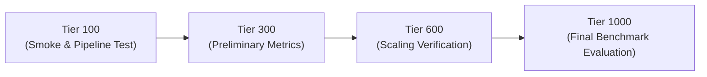

# XMCA-Net: Kaggle Dual-GPU Execution Plan

This document outlines the resource allocation, multi-GPU sharding, and progressive execution strategy for running XMCA-Net experiments on Kaggle dual NVIDIA T4 GPUs.

---

## 1. Hardware Environment & Boundaries

- **Target Accelerator**: 2 × NVIDIA T4 Tensor Core GPUs (16 GB GDDR6 VRAM each, ~30–32 GB total VRAM).
- **CPU / Host Memory**: ~30 GB RAM.
- **Disk Storage**: ~73 GB available on `/kaggle/working`.
- **Absolute Boundary**: **Zero model training or inference on local development machines (macOS/CPU).** Local environments are used strictly for code authoring, configuration validation, schema checks, and repository maintenance.

---

## 2. Multi-GPU Memory Allocation Strategy

Each candidate model (LLaVA-1.5-7B, Qwen2-VL-7B, InternVL2-8B) contains 7–8 billion parameters.

In half-precision (`float16`):
- Model weights: ~14–16 GB.
- Visual token cache + attention activations: ~2–4 GB.

### Sharding Design:
```
           +-----------------------------------------------+
           |               Kaggle Host (Dual T4)           |
           +-----------------------------------------------+
                                   |
         +-------------------------+-------------------------+
         |                                                   |
         v                                                   v
+-------------------------------+   +-------------------------------+
|     NVIDIA T4 (GPU 0)         |   |     NVIDIA T4 (GPU 1)         |
|  - VRAM Budget: ~14 GiB       |   |  - VRAM Budget: ~14 GiB       |
|  - Vision Encoder & Layers 0-15|  |  - Decoder Layers 16-31       |
|  - Visual Attention Maps      |   |  - Language Head & Logits     |
+-------------------------------+   +-------------------------------+
```

- Utilizing HuggingFace `accelerate` with `device_map="auto"` and `max_memory={0: "14GiB", 1: "14GiB"}`.
- GPU 0 processes the visual encoder, image projections, and the first half of transformer decoder layers.
- GPU 1 processes the remaining transformer layers and the language generation head.

---

## 3. Progressive Evaluation Stages

To avoid timeout issues, prevent out-of-memory errors, and detect discrepancies early, experiments execute across four progressive sample tiers:



### Stage Milestones:
1. **Tier 100**:
   - Verify pipeline execution on 100 matched samples across all 4 datasets.
   - Confirm generation outputs match schema and latency is within budget.
2. **Tier 300**:
   - Compute preliminary $S_P, S_R, S_U$ consistency scores.
   - Check calibration metrics stability.
3. **Tier 600**:
   - Verify consistency trends and failure modes under larger sample size.
4. **Tier 1000**:
   - Full benchmark evaluation.
   - Run calibrated combiner and cause-attribution evaluation on POPE & FaithScore.
   - Produce final reproducibility reports.

---

## 4. Artifact Persistence Protocol

In Kaggle notebook sessions:
1. Pull clean repository code from GitHub.
2. Run `notebooks/XMCA_BOOTSTRAP_KAGGLE.ipynb` to verify GPUs and dependencies.
3. Save all outputs under `artifacts/` hierarchy:
   - `artifacts/manifests/`: Run manifests with matched sample IDs.
   - `artifacts/generations/`: Raw model token generations (`.jsonl`).
   - `artifacts/features/`: Extracted consistency diagnostic vectors.
   - `artifacts/reports/`: JSON metric summaries and markdown tables.
4. Export artifacts using Kaggle output persistence or git push back to the repository.

