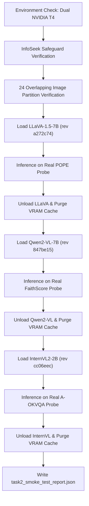

# XMCA-Net: Task 2 VLM Smoke Test Protocol

This document specifies the verification protocol for executing the Task 2 smoke test on Kaggle Dual NVIDIA T4 accelerators.

---

## 1. Objective

To prove end-to-end functionality of all three VLM adapters:
1. Receive real images and questions.
2. Load authentic model weights in FP16 on dual NVIDIA T4 GPUs.
3. Generate non-empty, genuine answers through the unified XMCA interface.
4. Measure latency and memory allocation.
5. Successfully reclaim VRAM between backbones without memory leakage.

---

## 2. Test Execution Assets

- **Notebook**: [`notebooks/XMCA_TASK2_VLM_SMOKE_TEST.ipynb`](file:///Users/ketharajupallivenkat/Desktop/XMCA_NET_SRC/notebooks/XMCA_TASK2_VLM_SMOKE_TEST.ipynb)
- **CLI Script**: [`scripts/kaggle_vlm_smoke_test.py`](file:///Users/ketharajupallivenkat/Desktop/XMCA_NET_SRC/scripts/kaggle_vlm_smoke_test.py)
- **Report Destination**: `artifacts/reports/task2_smoke_test_report.json`

---

## 3. Smoke Test Procedure



---

## 4. Verification Criteria

| Checkpoint | Requirement | Verification Method |
|:---|:---|:---|
| **GPU Detection** | Exactly 2 NVIDIA T4 GPUs detected with ~15GB VRAM each. | `torch.cuda.device_count() >= 2` |
| **InfoSeek Guard** | Accessing un-materialized OVEN images throws explicit blocked error. | Unit test + smoke test orchestrator probe |
| **Overlapping Image Exclusion** | Overlapping images barred from all calibration & training partitions. | `verify_partition_isolation(..., 'calibration')` |
| **LLaVA-1.5-7B** | Loads in FP16 with `device_map='auto'`, generates genuine text. | Generation output verified, VRAM < 14 GiB/device |
| **Qwen2-VL-7B** | Loads in FP16 with native dynamic processor, generates genuine text. | Generation output verified, VRAM < 14 GiB/device |
| **InternVL2-2B** | Dynamic image patch preprocessing produces 448x448 tiles, chat API succeeds. | Generation output verified, VRAM < 6 GiB |
| **Memory Reclamation** | VRAM returns to baseline (~0.0 GiB) between model loads. | `torch.cuda.memory_allocated()` check |

---

## 5. Kaggle Execution Instructions

1. Push latest repository commits to GitHub.
2. In Kaggle, create or update the XMCA-Net Notebook.
3. Under **Notebook settings**:
   - **Accelerator**: `GPU T4 x 2`
   - **Persistence**: `Files only`
   - **Internet**: `On`
4. Under **Add-ons -> Secrets**:
   - Add `HF_TOKEN` with access to gated Hugging Face resources.
5. Run [`notebooks/XMCA_TASK2_VLM_SMOKE_TEST.ipynb`](file:///Users/ketharajupallivenkat/Desktop/XMCA_NET_SRC/notebooks/XMCA_TASK2_VLM_SMOKE_TEST.ipynb) or execute:
   ```bash
   python scripts/kaggle_vlm_smoke_test.py --output artifacts/reports/task2_smoke_test_report.json
   ```
6. Download the persisted `artifacts/reports/task2_smoke_test_report.json`.
